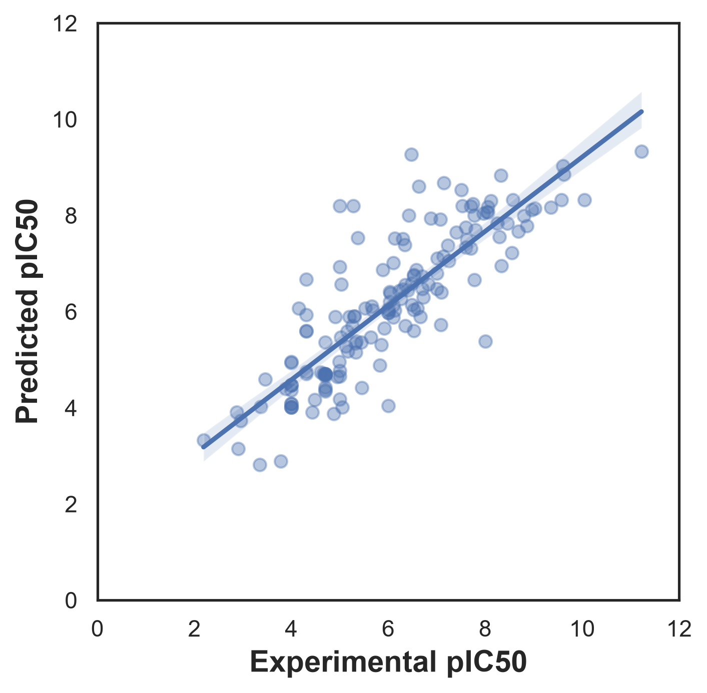

# EGFR Drug Discovery: Machine Learning for Bioactivity Prediction

## Overview

This project explores a computational drug-discovery workflow for predicting the bioactivity of small molecules against the epidermal growth factor receptor (EGFR), a protein involved in cell growth and signaling and an important target in cancer research.

The pipeline combines bioactivity data retrieval, chemical structure processing, molecular fingerprint generation, machine learning, and a Streamlit interface.

## Objectives

- Retrieve EGFR bioactivity records from ChEMBL.
- Explore molecular properties and bioactivity distributions.
- Generate molecular fingerprints using PaDEL.
- Train and evaluate a machine-learning regression model to predict pIC50.
- Build an interactive app for molecular bioactivity prediction and Lipinski descriptor inspection.

## Workflow

1. **Data acquisition:** Retrieve relevant EGFR bioactivity records from ChEMBL.
2. **Data preparation:** Inspect and curate chemical structures and bioactivity measurements.
3. **Exploratory analysis:** Examine pIC50 and molecular properties.
4. **Feature generation:** Calculate molecular fingerprints using PaDEL.
5. **Model development:** Train and evaluate a regression model.
6. **Application:** Use Streamlit to accept a SMILES input and display the model's prediction and selected molecular descriptors.

## Technologies

- Python
- pandas
- ChEMBL web resource client
- RDKit
- PaDEL-Descriptor
- scikit-learn
- Streamlit
- Jupyter Notebook

## Results

The Random Forest regression model was developed to predict the bioactivity of small molecules against EGFR using molecular fingerprints as input features and pIC50 as the prediction target.

### Model Evaluation

The dataset contained **791 molecules** and was split into **80% training data and 20% testing data** for model evaluation.

- **Test-set R²:** 0.7036
- **Training strategy:** 80/20 train-test split
- **Model:** Random Forest Regression

The test-set R² of 0.7036 indicates that the model explains approximately **70.4% of the variation in pIC50 values** in the held-out test set. This provides a promising baseline, although further validation is needed to determine how reliably the model predicts bioactivity for unseen compounds.

### Final Model for the Web Application

After evaluation, the model was trained using the full dataset of 791 molecules for use in the Streamlit application. The resulting R² of 0.9606 was obtained when evaluating predictions on the same data used for training.

This higher R² reflects the model's fit to the training data and should not be interpreted as independent evidence of predictive performance. The held-out test-set R² is the more appropriate metric for estimating generalization to unseen molecules.

### Limitations and Future Improvements

Potential improvements include:

- Expanding the training dataset beyond the initial 791 molecules.
- Evaluating generalization using scaffold-based splitting and cross-validation.
- Investigating the effects of chemical diversity, data quality, and assay variability.
- Assessing prediction uncertainty before applying the model to novel compounds.

**Note:** Predicted pIC50 values are computational estimates and require experimental validation.

## Limitations

Predictions depend on the quality and chemical diversity of the training data, the assay conditions, and the applicability of the model to new compounds. Predicted pIC50 values are computational estimates and do not establish experimental potency, clinical efficacy, or safety.

## Reproducibility

*Add installation instructions, the required package versions, data retrieval steps, and model artifact instructions before publishing.*

## Data and references

- ChEMBL: https://www.ebi.ac.uk/chembl/
- RDKit: https://www.rdkit.org/
- PaDEL-Descriptor: https://doi.org/10.1002/jcc.21707

## Disclaimer

This is an educational computational research project, not a validated tool for selecting clinical drug candidates.
